# GBA Emulator

[](https://github.com/amyanger/gba-emulator/actions/workflows/ci.yml)
[](https://github.com/amyanger/gba-emulator/actions/workflows/release.yml)
[](https://github.com/amyanger/gba-emulator/releases/latest)

A Game Boy Advance emulator written from scratch in C, featuring **Hardware X-Ray Mode**: a real-time view of what the GBA hardware is actually doing while a game runs.

No other GBA emulator offers this. Every emulator is a black box. This one lets you see inside.

Built around an ARM7TDMI CPU interpreter, scanline-based PPU, and an SDL2 frontend. No external libraries beyond SDL2. Pokemon Emerald is fully playable end-to-end.

**Jump to:** [Download](#download) · [Features](#features) · [Screenshots](#screenshots) · [Quick start](#quick-start) · [Building](#building-from-source) · [Documentation](#documentation)

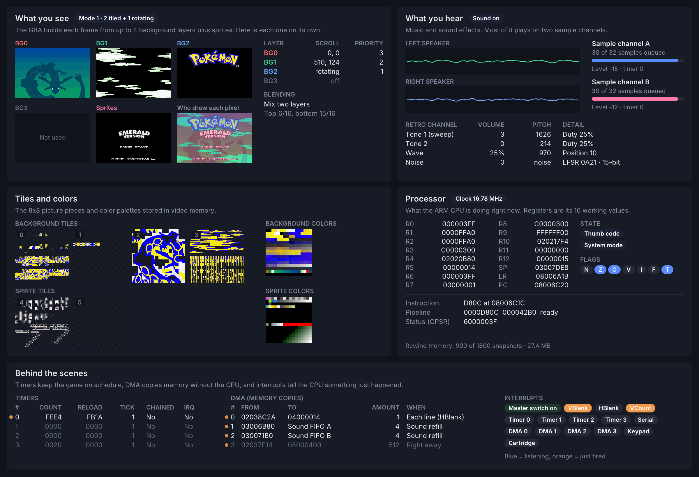

## Download

Ready-to-run apps for **macOS** (Apple Silicon), **Windows** and **Linux** are on the [latest release](https://github.com/amyanger/gba-emulator/releases/latest). Download the one for your system, double-click it and pick a game from the library. There's nothing else to install.

| System | File |
|--------|------|
| macOS 11+ (Apple Silicon) | `gba_emulator-<version>-macOS-arm64.dmg` |
| Windows (64-bit) | `gba_emulator-<version>-Windows-AMD64.zip` |
| Linux (x86_64) | `gba_emulator-<version>-x86_64.AppImage` |

The apps aren't signed with a paid certificate, so macOS and Windows ask you to confirm the first time you open them. [Installing a pre-built binary](docs/usage.md#installing-a-pre-built-binary) has step-by-step instructions for each system.

## Features

### Every game

| Feature | Key | What it does |
|---------|-----|--------------|
| **[Hardware X-Ray Mode](docs/hardware-xray.md)** | F2 | A second window showing background layers, sprites, tiles, palettes, audio channels, CPU registers, timers, DMA and interrupts as the game runs. |
| **[Save states and rewind](docs/usage.md#controls)** | F5 / F8, Backspace | 10 save-state slots, plus hold Backspace to rewind up to 60 seconds. |
| **[Fast-forward](docs/usage.md#controls)** | Tab | Hold to speed up. Screenshots and fullscreen are in the controls list. |
| **[Input display and frame advance](docs/usage.md#controls)** | F3, `\` | Show the buttons you're holding on screen, or step through the game one frame at a time. |
| **[Game library](docs/usage.md#game-library)** | | Opens when you start the app without a game, with your games folder, recently played games and a Continue playing button. |
| **[Settings](docs/usage.md#settings)** | Ctrl+, (Cmd+,) | Change keyboard and controller buttons, set up turbo A and B, and pick the fast-forward speed, volume and BIOS. |
| **[Cheats](docs/usage.md#cheats)** | | Paste CodeBreaker, GameShark or Action Replay codes as found online. Your save is backed up before any cheat runs. |
| **[ROM patches](docs/usage.md#rom-patches)** | | Play IPS, UPS and BPS hacks and translations without patching the ROM. Each patched game keeps its own save. |
| **[Link cable](docs/usage.md#link-cable)** | | Two windows on the same machine can trade and battle. |
| **[Screen filters](docs/usage.md#screen-filters)** | | Smooth out jagged pixel edges and match the colors of a real GBA screen. |
| **[HQ music](docs/hq-music.md)** | H | Game music re-mixed in high quality for games that use the standard MP2K sound driver. |

### Pokémon Companion

These need the original, unmodified US/English ROM of Pokémon Emerald, FireRed (1.0) or LeafGreen (1.1). Every other game still runs normally.

| Feature | Key | What it does |
|---------|-----|--------------|
| **[Pokémon Companion](docs/pokemon-companion.md)** | F9 | A side panel with live info from your game. F10 switches pages. Works with Emerald, [FireRed and LeafGreen](docs/pokemon-companion.md#firered-and-leafgreen). |
| &nbsp;&nbsp;[Battle](docs/pokemon-companion.md#battle) | | The opponent's IVs, nature, ability and held item, move matchups both ways, and in wild battles the catch odds for each ball. |
| &nbsp;&nbsp;[Damage](docs/pokemon-companion.md#damage) | | Predicted damage as a percent of HP on every move in a battle, with KO coloring, for your moves and the enemy's. |
| &nbsp;&nbsp;[Party](docs/pokemon-companion.md#party) | | Your Pokemon's hidden stats: IVs, EVs, Hidden Power, friendship. |
| &nbsp;&nbsp;[Move relearner](docs/pokemon-companion.md#move-relearner) | | The next move each Pokemon learns by level, and what the move relearner can teach it before you spend a Heart Scale. |
| &nbsp;&nbsp;[Daycare](docs/pokemon-companion.md#daycare) | | Your Daycare Pokemon, egg odds and the next roll, what the egg will be (on Emerald even whether it's shiny) and steps until each egg hatches. |
| &nbsp;&nbsp;[Trainer card](docs/pokemon-companion.md#trainer-card) | C | Save a shareable picture of your team, as a grid or with your ace up front. |
| &nbsp;&nbsp;[Route](docs/pokemon-companion.md#route) | | The wild encounter table for where you are, with caught Pokemon checked off. |
| &nbsp;&nbsp;[Roaming](docs/pokemon-companion.md#roaming) | | Where Latias, Latios or the legendary dogs are roaming right now, with their HP and status, and a heads-up when they're on your route. |
| &nbsp;&nbsp;[Mirage Island](docs/pokemon-companion.md#mirage-island) | J, twice | Which of your Pokemon raises Mirage Island today and when it next will, then jump the clock to that day. (Emerald only) |
| &nbsp;&nbsp;[Nuzlocke](docs/pokemon-companion.md#nuzlocke) | N | Logs each area's first encounter, every death and any reload after a death. |
| &nbsp;&nbsp;[Berries](docs/pokemon-companion.md#berries) | B | Every berry tree you've planted, with growth, watering and countdowns, plus a toast when berries are ripe, need water or are about to drop. (Emerald only) |
| &nbsp;&nbsp;[Search](docs/pokemon-companion.md#search) | / | Type a Pokemon's name to see every wild spot with levels and odds, or how to get it by evolution or breeding. |
| &nbsp;&nbsp;[Hunt](docs/pokemon-companion.md#hunt) | [ ] | Shiny hunting in tall grass: counts every encounter, shows the next Pokemon and when a match comes up. (Emerald only) |
| &nbsp;&nbsp;[Run stats](docs/pokemon-companion.md#run) | F10 | Your playthrough's story: badge art and times, catches, faints, evolutions, an MVP and the game's own counters. |
| **[Overworld X-Ray](docs/pokemon-companion.md#overworld-x-ray)** | F4 | Trainer sight lines, item names, NPC gifts and the hidden Feebas tiles drawn right on the map. (Emerald only) |
| **[Following Pokemon](docs/usage.md#following-pokemon)** | F1 | Your lead Pokemon walks behind you and talks like it does in HeartGold and SoulSilver, using your own HeartGold or SoulSilver ROM (Emerald only). |

## Screenshots

<table>
<tr>
<td width="50%"><a href="docs/pokemon-companion.md#battle">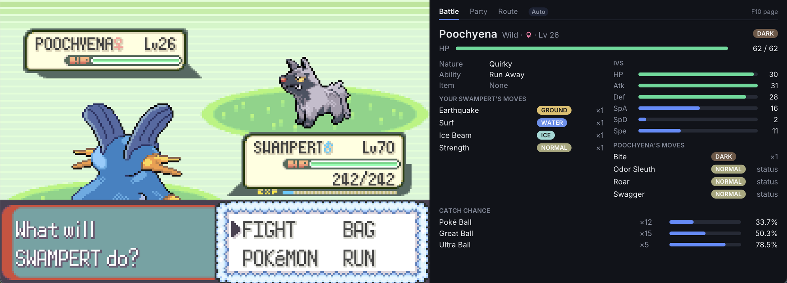</a><br><b>Battle:</b> IVs, nature and matchups for a wild Poochyena</td>
<td width="50%"><a href="docs/pokemon-companion.md#berries">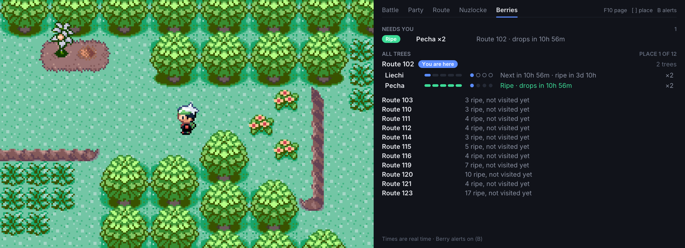</a><br><b>Berries:</b> a ripe Pecha, 10 hours before it drops</td>
</tr>
<tr>
<td><a href="docs/pokemon-companion.md#run">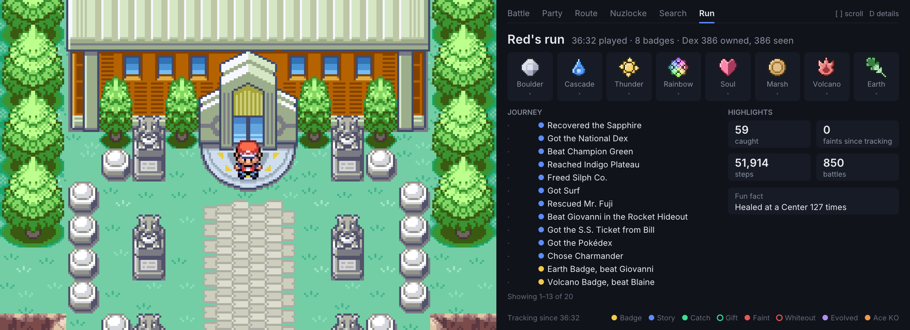</a><br><b>Run (FireRed):</b> badges, story and highlights after the Hall of Fame</td>
<td><a href="docs/pokemon-companion.md#firered-and-leafgreen">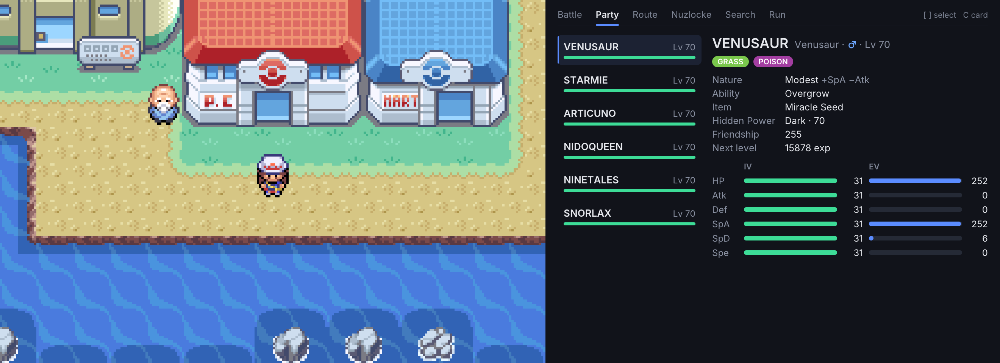</a><br><b>Party (LeafGreen):</b> hidden stats on Cinnabar Island</td>
</tr>
<tr>
<td><a href="docs/pokemon-companion.md#nuzlocke">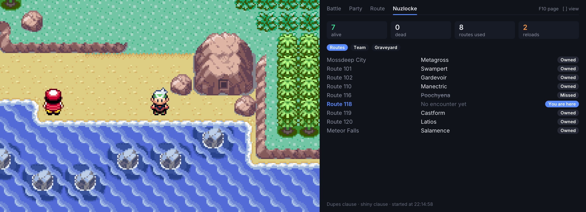</a><br><b>Nuzlocke:</b> every area used and what you met there</td>
<td><a href="docs/pokemon-companion.md#mirage-island">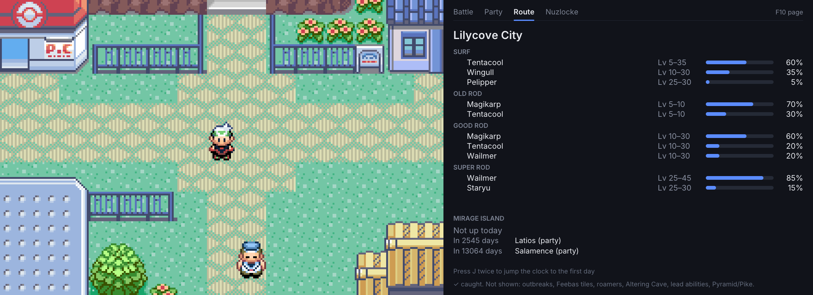</a><br><b>Mirage Island:</b> which Pokemon raises it, and when</td>
</tr>
<tr>
<td><a href="docs/usage.md#following-pokemon">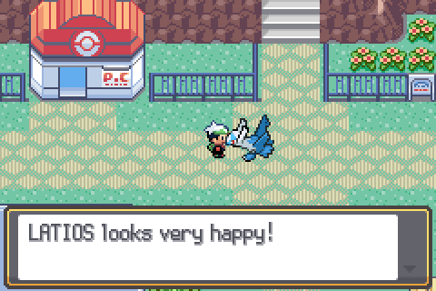</a><br><b>Following Pokemon:</b> Latios in Lilycove City</td>
<td><a href="docs/pokemon-companion.md#party">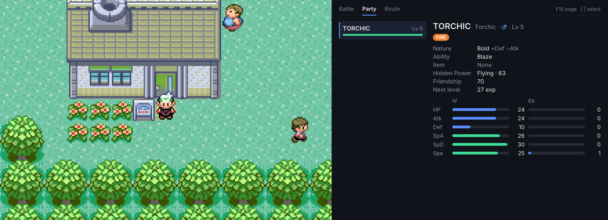</a><br><b>Party:</b> hidden stats for each Pokemon</td>
</tr>
<tr>
<td><a href="docs/pokemon-companion.md#search">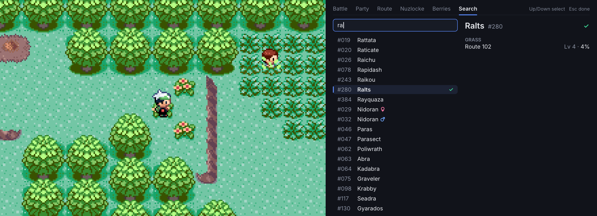</a><br><b>Search:</b> the list narrows as you type</td>
<td><a href="docs/pokemon-companion.md#search">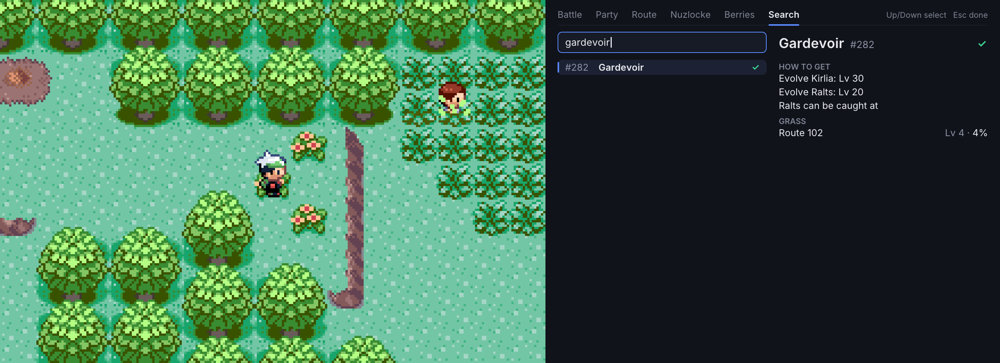</a><br><b>Search:</b> not wild? It shows the evolution path</td>
</tr>
</table>

## Quick start

Open the app and pick a game from the library, or run it from a terminal:

```bash
./build/gba_emulator path/to/rom.gba --scale 3
```

| Key | GBA button |
|-----|------------|
| Z / X | A / B |
| Enter / Right Shift | Start / Select |
| Arrow keys | D-Pad |
| A / S | L / R |

| Key | Does |
|-----|------|
| F2 | Hardware X-Ray Mode |
| F4 | Overworld X-Ray (Pokemon Emerald) |
| F9 | Pokémon Companion (Emerald, FireRed, LeafGreen) |
| F5 / F8 | Save / load state |
| Tab (hold) | Fast-forward |
| Backspace (hold) | Rewind |
| Space | Pause |
| F11 | Fullscreen |

On macOS, hold **fn** with the F-keys unless your keyboard is set to use them as standard function keys. Saves are written next to the ROM. The [full controls list and every command-line option](docs/usage.md) are in the usage guide.

## Building from source

You need SDL2 2.0+, CMake 3.21+ and a Rust toolchain (`brew install sdl2 cmake rust` on macOS; on Linux `apt install libsdl2-dev cmake` plus Rust from [rustup.rs](https://rustup.rs)).

```bash
mkdir -p build && cd build
cmake .. -DCMAKE_BUILD_TYPE=Release
make
```

Build options, the architecture, the test suite and the golden-frame checks are in the [development guide](docs/development.md).

## Documentation

- [Using the emulator](docs/usage.md): installing, the game library, command-line options, all controls, settings, screen filters, Following Pokemon, headless mode, link cable, cheats
- [Pokémon Companion and Overworld X-Ray](docs/pokemon-companion.md)
- [Hardware X-Ray Mode](docs/hardware-xray.md)
- [HQ music](docs/hq-music.md)
- [Development](docs/development.md): building, what's emulated, architecture, project structure, testing, roadmap, references

## License

This project is open source. See [LICENSE](LICENSE) for details.

---

**Note**: You must supply your own GBA BIOS and ROM files. They are not included in this repository.
