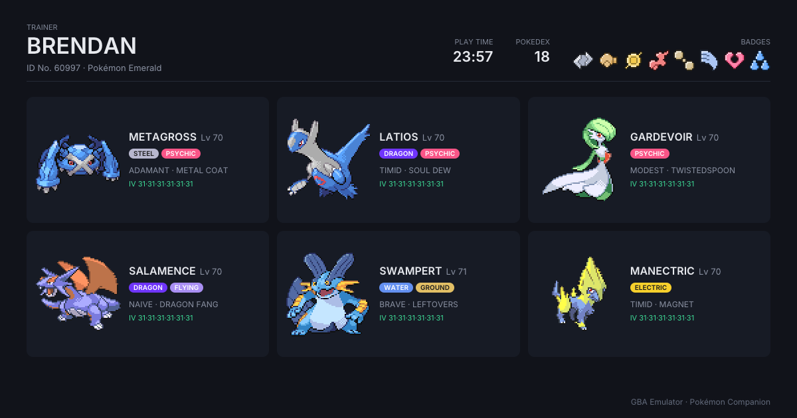
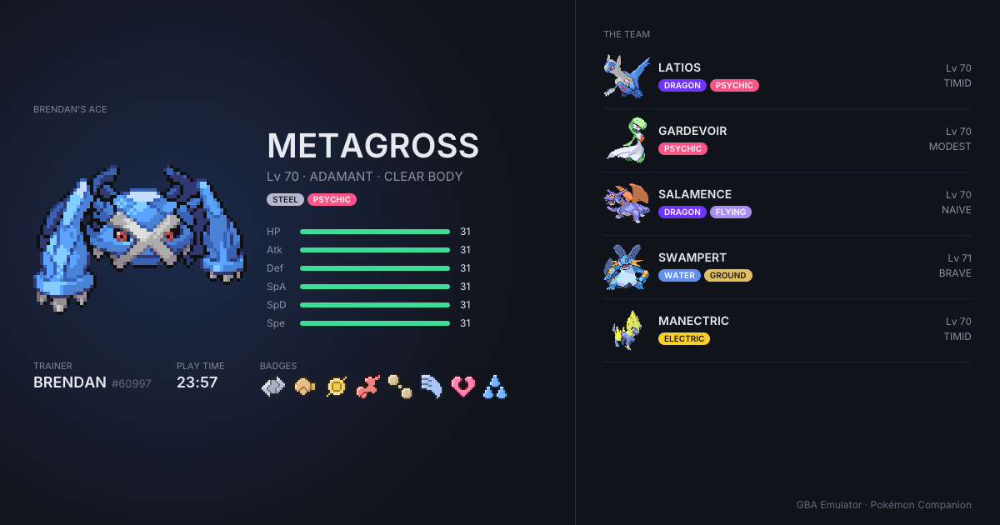
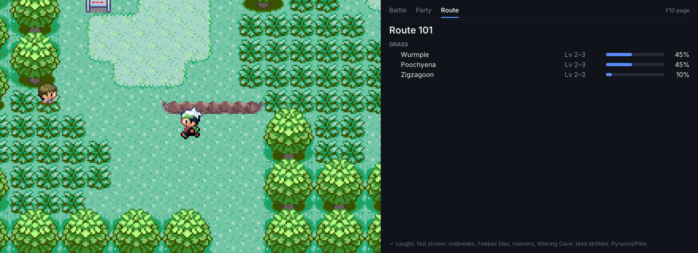
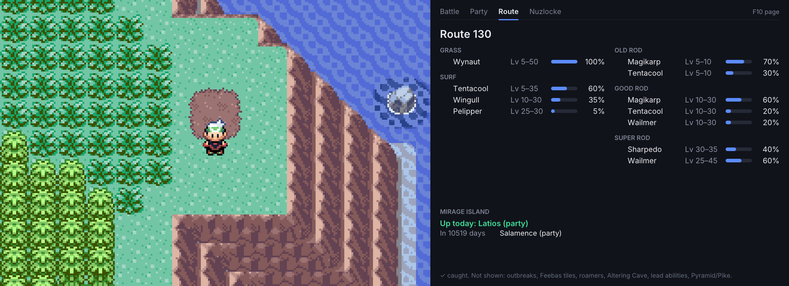
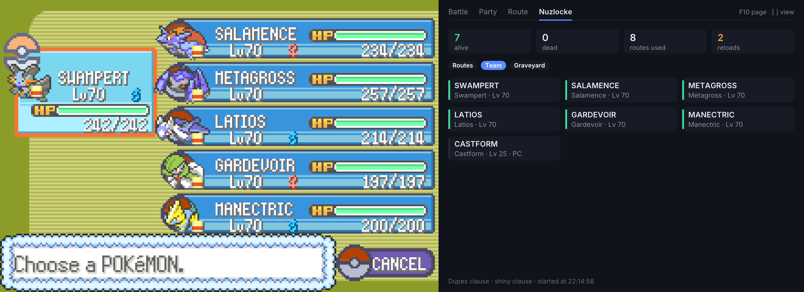
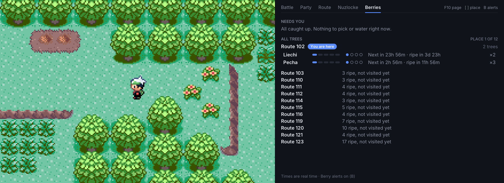
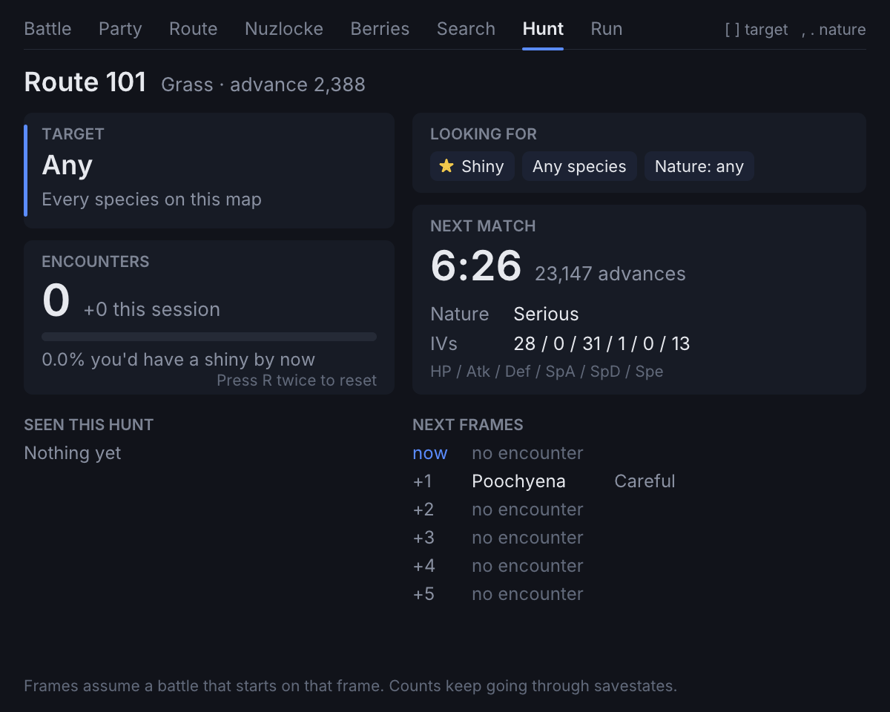
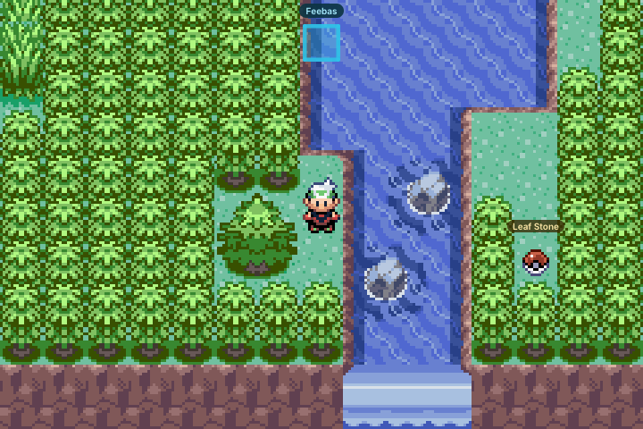
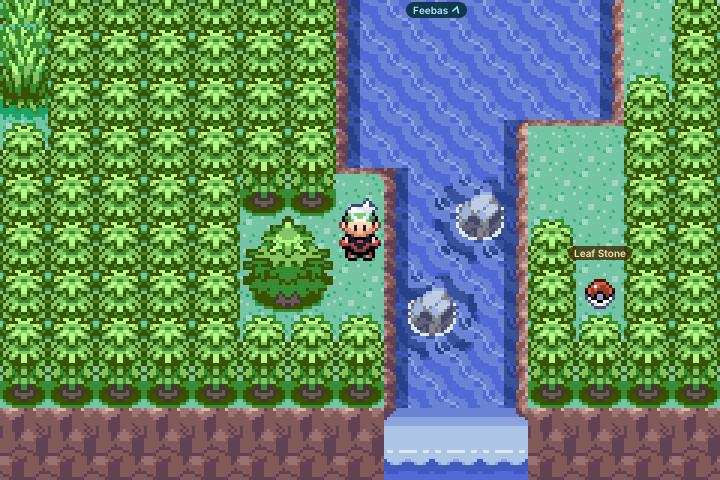
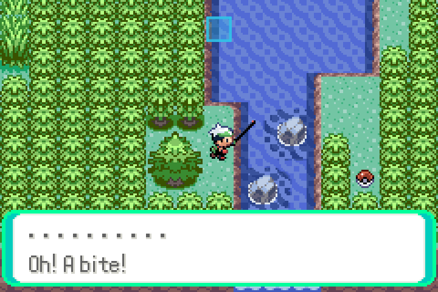

# Pokémon Companion

Pokémon Companion is a side panel that shows live info from your Pokémon Emerald, FireRed or LeafGreen game. It has pages for the battle you're in, your party's hidden stats, the wild Pokemon where you are, a Nuzlocke run, your berry trees (Emerald only), a Pokemon search, a shiny hunting page (Emerald only) and the story of your playthrough. Press **F9** to open it next to the game.

**On this page:** [FireRed and LeafGreen](#firered-and-leafgreen) · [Battle](#battle) · [Party](#party) · [Route](#route) · [Mirage Island](#mirage-island) · [Nuzlocke](#nuzlocke) · [Berries](#berries) · [Search](#search) · [Hunt](#hunt) · [Run](#run) · [Details](#details) · [Keys](#keys) · [Overworld X-Ray](#overworld-x-ray)

> [!IMPORTANT]
> **Pokémon Companion only works with original, unmodified US/English ROMs of Pokémon Emerald, FireRed (version 1.0) or LeafGreen (version 1.1).** These are the versions it was built and tested with.
>
> - **ROM hacks are not supported**, even ones based on these games. The panel shows "ROM hack not supported" instead of guessing.
> - **Other revisions** (such as FireRed 1.1 or LeafGreen 1.0), **other languages** (Japanese, French, German, Spanish, Italian) and **other Pokemon games** (Ruby, Sapphire) are not supported. The panel shows "not supported" and names the three ROMs it works with.
>
> In every case the game itself still runs normally. Only the panel is unavailable.
>
> The check compares your whole ROM file against the original's CRC32 checksum. If you're not sure which version you have, load your game and press F9. If the panel doesn't say "not supported", your ROM works.

## FireRed and LeafGreen

The panel also works with the original US/English Pokémon FireRed (version 1.0) and LeafGreen (version 1.1) ROMs. Other revisions and ROM hacks show a "not supported" page and play normally.

What works there: Battle with damage and catch odds, Party, the Daycare block on the Party page, Route, Search, Nuzlocke, Run and the trainer card.

Differences from Emerald:

- Berries, Hunt, Mirage Island, Feebas tiles, Overworld X-Ray (F4) and Following Pokemon (F1) are Emerald only. The Berries and Hunt tabs are hidden.
- The Daycare is the one on Four Island. An egg's species, gender and ability show as soon as it's waiting. Its nature, IVs and shininess are only rolled when you pick it up, so the panel can't show them. The one-Pokémon day care on Route 5 isn't shown yet.
- In the Pokémon Tower the Battle page shows "Ghost" until the Silph Scope reveals it, and ghosts can't be caught.
- Search says "Not in this game, trade it" for evolutions FireRed and LeafGreen can't do: high friendship by day or night, and Beauty.
- The Run page's story beats are Kanto's: S.S. Ticket, Rocket Hideout, Mr. Fuji, Surf, Silph Co., Indigo Plateau, the Champion and the Hall of Fame (shown together, since the game only keeps that flag), the National Dex and the Sapphire. Your rival's name is used for rival and Champion battles.
- While the game replays "Previously on your quest..." after Continue, the panel waits and nothing is logged. Teachy TV's demo battles are never logged either.

## Keys

| Key | Panel action |
|-----|--------------|
| F9 | Show or hide the panel |
| F10 | Cycle the page: Auto, Party, Route, Nuzlocke, Berries, Search, Hunt, Run (Berries and Hunt are Emerald only and hidden on FireRed and LeafGreen). Auto shows the battle page during a battle and the route page otherwise. When a battle starts the panel switches to Auto, and when it ends it goes back to the page you had, unless you changed the page during the battle. |
| [ and ] | Select the previous or next Pokemon on the Party page, switch views on the Nuzlocke page, open the previous or next place on the Berries page, move the Search selection, pick the target species on the Hunt page, or scroll the list on the Run page |
| N | Start a Nuzlocke run, on the Nuzlocke page |
| J, twice | Move the clock to the next Mirage Island day, on the Route page |
| B | Turn berry alerts on or off, on the Berries page |
| / | Start typing a Pokemon name, on the Search page |
| , and . | Pick the nature the Hunt page looks for |
| R, twice | Reset the Hunt page's encounter counts |
| D | Switch between the Run page's dashboard and its Details sheet |

On macOS, hold **fn** with the F-keys (fn+F9, fn+F10), unless your keyboard is set to use F1, F2 and so on as standard function keys. `[`, `]`, `,`, `.`, `N`, `J`, `B`, `R`, `/` and `D` only work on their pages, and only when they are not bound to a GBA button in a custom keymap.

## Battle

The opposing Pokemon's species, level, HP, types, nature, IVs, ability, held item and any status condition, how your active Pokemon's moves match up against it, the opponent's own moves and how they match up against your active Pokemon, and, in wild battles, the catch chance for each ball in your bag. For the opponent's moves the colors are from your side: red means a move is super effective against you, green means you resist it or are immune. In a double battle a line under the name shows the second opponent's species, level and HP.

The panel switches to this page by itself when a battle starts, even if you were on Party or Route, and goes back to your page when the battle ends.

### Damage

Every move row shows the damage it would do, as a percentage of the target's max HP. Your active Pokemon's moves are measured against the main enemy, and the enemy's moves against your active Pokemon.

The number is a normal, non-critical hit, given as the lowest and highest result of the game's 16 random rolls. It is worked out from the battle stats the game is actually using right now, so level, nature, EVs, IVs, stat changes, abilities, held items, badges, weather, Reflect and Light Screen all count. It updates live as the battle goes on.

| Shown | Meaning |
|-------|---------|
| 38–45% | The range of the 16 rolls. |
| 40% | Every roll does the same damage. |
| <1% | The move does less than 1% of the target's HP. |
| <1–5% | The low rolls do less than 1%. |
| 850%+ | Over 999% at the top end, with the lowest roll shown. |
| >999% | Even the lowest roll is over 999%. |
| OHKO | A one-hit KO move that can hit. |
| fails | The move cannot work right now, for example Dream Eater on an awake target. |
| ×0 | The target is immune, including through Levitate, Wonder Guard, Soundproof against a sound move, or an ability that absorbs the move's type. |

A muted ×2 or ×0.5 beside the move name is the type multiplier, shown when there is room for it.

The color of the number says whether the move can finish the target from its current HP:

- Green, for your moves, or red, for the enemy's, means every roll is a KO.
- Amber means some rolls are a KO.
- Muted means no KO is shown. This is used when the target is behind a Substitute, and when it is in the middle of Fly, Dig or Dive, because whether your move lands depends on who moves first. False Swipe never counts as a KO, since it leaves 1 HP.

Some moves fall back to the older ×2 or ×0.5 matchup display because their damage cannot be known ahead of time: multi-hit moves, Psywave, Magnitude, Present, Rollout, Ice Ball, Fury Cutter, Revenge, Counter, Mirror Coat, Bide, Future Sight, Doom Desire and Beat Up. The same happens when a Pokemon holds an Enigma Berry, in Safari Zone battles, and for moves whose power varies, or that hit harder against Fly, Dig, Dive or Minimize, while the user is locked into a multi-turn move.

Not modelled: critical hits, accuracy, Helping Hand, and redirection from Lightning Rod or Follow Me. In double battles only the main enemy gets numbers. Right after a switch-in the numbers take a moment to settle.

The calculation follows the damage code in pokeemerald. Its unit fixtures were checked against two independent derivations, and the real in-game hits we compared against all landed inside the predicted ranges.

## Party

Each Pokemon's nature, ability, held item, Hidden Power type and power, friendship, experience to the next level, IVs and EVs. Use `[` and `]` to move between Pokemon.

### Daycare

When you have Pokemon at the Daycare, or an egg is waiting there, a Daycare block appears under the party rows. Otherwise the Party page looks as it always has. Select a row with `[` and `]`, or step past the last party Pokemon.

- **Parents.** One row per Pokemon at the Daycare. Its detail view is the usual party view, except that the next-level line becomes how many steps it has spent there, how many levels that is worth, and its "Pickup cost" (100 plus 100 per level gained).
- **Breeding row.** How well the two get along, as the game's own message and a percentage, which is the chance of an egg on each roll. It also shows how many steps are left until the next roll, and the row in the list reads "Egg ready" once an egg is waiting. A roll happens every 256 steps, and only when the pair can breed and no egg is already waiting. If they can't breed it says why: two of the same gender, a genderless Pokemon, no shared egg group, two Ditto, or a Pokemon that can't breed at all.
- **The waiting egg.** Once an egg is ready, the row shows what it will be: species, gender, nature, ability and whether it is shiny ("Shiny  Yes"). All of this is already decided when the egg appears, even though you haven't picked it up. IVs are not shown, because the game rolls them when you take the egg.
- **Eggs in your party.** An egg's row and detail view show the steps until it hatches. If a Magma Armor or Flame Body Pokemon is in the party, the detail view adds an "Egg cycles" row reading "2 per check". The game only checks every 256 steps and hatches one egg per check, so with two eggs the second one's count includes the extra check the first one used.

Steps here are the steps the game counts. Walking and biking count. Steps on ice, steps carried by water currents or spin tiles, and steps where a script fires don't count, so the numbers on this page don't move for those.

**Egg alert.** While you play, with or without the panel open, a toast says "Egg ready at the Daycare". Its second line is the species, followed by ", shiny" when it is. If the species can't be worked out, it says "Talk to the old man on Route 117" instead. It appears once per egg, waits until a battle is over, and stays quiet for an egg that was already waiting when you opened the game.

## Trainer card

Press `C` to save a picture of your team as a PNG, ready to share. It works with the panel open or closed, and while the game is paused. The file goes next to the ROM as `<rom>.YYYYMMDD-HHMMSS.card.png`, the same way F12 screenshots do. If you bind `C` to a GBA button, the key is ignored.

- **Team grid (`C`).** Your trainer name, ID, play time, Pokedex count and badges across the top, then all six Pokemon with level, types, nature, held item and IVs.
- **Ace showcase (`Shift+C`).** One Pokemon large on the left with its nature, ability, types and IV bars, and the rest of the team listed on the right.

The ace is the selected row when the panel is on the Party page. Otherwise it is the MVP of your Run log, if one is attached and that Pokemon is in your party, and failing that your first Pokemon that isn't an egg.

A toast confirms the save. The card isn't made in the Battle Tents, the Battle Frontier facilities (Tower, Dome, Palace, Pyramid, Arena, Factory and Pike) or Trainer Hill, in partner battles or in link battles. It needs a game in progress with at least one Pokemon, since it reads the party from RAM and works before the first save.

Some things are left out on purpose. Unown always shows as an A and Spinda has no spots. Eggs are shown as eggs, so they stay a surprise. Only your public trainer ID is printed, never the secret half. From the command line, `--card-out` renders the same card (see [usage](usage.md)).

## Route

The name of the route, town or city you're in, read from the game's region map, and its wild encounter table with level ranges and odds. Pokemon you've caught are marked with a check.

### Mirage Island

Mirage Island is the rare island on Route 130 where Wynaut lives and the Liechi Berry grows. Emerald rolls a random number once a day, and the island is there only on days when that number matches part of a party Pokemon's personality value. With a full PC that can still be years apart, so most players never see it.

The Mirage Island card at the bottom of the Route page does the math for you:

- **Today.** Whether the island is up today, and which party Pokemon raises it. If the match is a Pokemon in your PC, the card names its box, so you can put it in your party.
- **Forecast.** The next three days one of your Pokemon will raise the island, counting your party and your whole PC.
- **Clock jump.** Press J twice within three seconds to move the cartridge clock to the first of those days.

After the jump, the game catches up the next time you go through a door (not inside a Pokemon Center). Have the named Pokemon in your party when you get to Route 130, and the island is there. The card shows "Up today" in green, and the Route page lists the island's Wynaut.

Things to know about the clock jump:

- Only the clock moves. Your save data isn't edited, and the new time is kept in the save file, so it survives closing the emulator.
- Berries, Shoal Cave tides, the lottery and the game's other daily events move forward too.
- The clock only moves forward, and there's no way to move it back from here. Copy your `.sav` file first if you want to keep the old date.
- The forecast stops at the end of 2099, the last date the cartridge clock can hold.

## Nuzlocke

Tracks a Nuzlocke run for the save you're playing. Open the Nuzlocke page and press **N** to start. Pokemon you already have join the run, and the routes they were caught on count as used.

From then on the tracker watches the game and keeps score:

- **Routes.** The first wild encounter in each area counts: grass, water, fishing and Rock Smash in one area share it. The page lists every area you've used, what you met there and whether you caught it, missed it or it has since died. Your current location stays in view.
- **Dupes clause.** An encounter whose evolution line is already in your run doesn't use up the area. Neither does a shiny.
- **Gifts.** Pokemon you're given (starter, eggs, Castform, Beldum, fossils, trades) join the run without using up an area.
- **Deaths.** A Pokemon that faints is dead for good, in battle or from poison on the field. Healing it is fine. Sending it back into battle is flagged as a rule break.
- **Reloads.** Loading a savestate, rewinding, or loading an older in-game save is counted. If you go back to before a death, the death still counts and the run is marked "reloaded after death". Battling again on an area you'd already used after a reload is flagged as a re-roll.

Use `[` and `]` to switch between **Routes**, **Team** (everyone in the run: green in your party, grey in the PC, red if dead) and **Graveyard** (each death with where it happened and what did it, plus the rule checks).

The run is saved as `<rom>.<trainer id>.nuzlocke` next to the ROM, one event per line. It is only ever added to, never rewritten. A new game or a different save file has a different trainer ID, so it gets its own run. To start over, delete that file.

Not tracked yet: level caps, badges, and trainer names on deaths.

## Berries

Keeps track of every berry tree in your game: what's growing, where it is, and when it needs you. Open the Berries page with F10.

- **Needs you.** At the top: trees that are ripe, about to drop their berries (red, under an hour left), or need water for the stage they're in, most urgent first.
- **All trees.** Below, one place at a time. The place you're standing on opens first and is marked "You are here". Each tree shows its growth stage, a drop for each of the four stages you can water it in (filled when watered, an orange ring when it needs water now, dark when that stage was missed), what happens next and how many berries to expect. Before a tree is ripe, the number is the most it can still give if you water every stage that's left. Other places sit underneath with a one-line summary. Use `[` and `]` to open them.
- **Empty soil.** Each place shows how many of its spots are free. With nothing planted, the page lists where the soft soil is.

Times are real time, because Emerald's clock is. The countdowns keep moving between the game's own updates, and they match what the game will do when you next go through a door. The trees the game plants on its own show as "ripe, not visited yet" until you walk past them, since they don't grow before that.

**Berry alerts.** While you play, with or without the panel open, a toast tells you when a tree becomes ripe, when it needs water for a new stage, when ripe berries are about to drop, and when you arrive somewhere with trees that need you. Trees on the map you're standing on stay quiet, events at the same place share one toast, and they wait until a battle is over. When you open a game, one toast sums up what needs you. Press **B** on the Berries page to turn alerts off or back on. The choice is remembered between launches.

## Search

Type part of a Pokemon's name and see where to get it in your game. Open the Search page with F10, then press `/` or click the box to start typing. The list narrows on every keystroke: an exact name comes first, then names that start with what you typed, then names that contain it. Spaces and punctuation are ignored, so "mr mime" and "hooh" work, and "nidoran" finds both Nidorans.

- **Keys.** Up and Down pick a result, or `[` and `]` when you're not typing. Home and End jump to the first and last result. Clicking a result picks it too. PageUp, PageDown or the mouse wheel scroll the details, and the wheel over the list scrolls the list. Enter or Esc stops typing, and Esc clears the text first if there is any. Ctrl+Backspace (Cmd+Backspace on macOS) clears the box, and Ctrl+V (Cmd+V) pastes into it.
- **While you type.** Letters and other keys don't reach the game or the emulator's letter hotkeys (M, H and so on), so typing a name won't press buttons. The F-keys still work, except F5 and F8, so a typed name can't save or load a state by accident. F6, F7, F9 and F10 also stop typing. A controller still plays. Esc never quits the emulator on this page, and a battle starting while you type doesn't switch the page away.
- **Details.** The national dex number and a check if you've caught it, then every wild spot: Grass, Surf, Dive, Rock Smash and the Old, Good and Super Rod, each with levels and encounter chance. When floors of the same place differ, the chance is shown as a range.
- **Special cases.** Feebas appears on Route 119 with any rod, on one of 6 hidden tiles. The Overworld X-Ray (F4) shows which ones. Wynaut on Mirage Island shows up only on days the island appears. Places that open after the Hall of Fame are listed under "After the Hall of Fame", and Shoal Cave's low tide spots are marked "Low tide".
- **Not wild.** The page works back to the nearest Pokemon you can catch and lists the steps. For Gardevoir that is: evolve Kirlia at Lv 30, evolve Ralts at Lv 20, and Ralts is on Route 102. Pokemon that only hatch from eggs say so and tell you which evolved form to breed, and Azurill needs a parent holding Sea Incense. Anything else says "Not found in the wild in <game>".

Gifts, legendaries, trades and roaming Pokemon aren't covered yet. Like the rest of the panel, every name and location is read from your own ROM.

## Hunt

A page for shiny hunting in tall grass. Open it with F10. It counts every wild encounter and shows what the next ones will be, so you can see how far into a hunt you are and when to expect a match. Shiny is always part of what it looks for.

- **Counting.** Every wild battle adds one to the total, and soft-reset static battles are counted too. Safari Zone and static battle detection has not been tested in a live game yet. The count keeps going through soft resets, savestates and rewinds and never rolls back. The page also shows how many were this session and the odds you'd have seen a shiny by now (with a target, a shiny of that species, from how many of it you've seen). Press **R** twice (the first press arms it for 3 seconds) to start the count over. A "Seen this hunt" list tallies each species.
- **Target.** `[` and `]` pick Any or one of the species on the current map. `,` and `.` pick a nature to look for, or any. The Looking for card shows the current filter.
- **Next match.** The time and the number of RNG advances until a step that finishes in tall grass would give a Pokemon matching your filter, with its nature and IVs.
- **Next frames.** Each row is one advance of the game's random number generator: what a step that finishes now would give, then what it would give one, two and up to five advances later. In the overworld the generator usually advances once a frame, hence the name. A row where the encounter roll fails says "no encounter". Each row shows the species, nature and whether it would be shiny.
- **Toast.** A toast appears when a shiny wild Pokemon shows up, with how many encounters it took.

The count is saved as `<rom>.<trainer id>.hunt` next to the ROM, one line per encounter, and is only ever added to.

**Not predicted.** Surfing, fishing, Rock Smash, Sweet Scent, the Safari Zone, maps with a mass outbreak, a lead Pokemon with Sand Veil, anything during a battle, and the first few steps after a battle or a warp. Some single steps are skipped too: the step where Repel wears off, and steps where the game does something else first (the friendship check every 128 steps, the Match Call check every 10 steps once you have it, a Day Care egg check or hatch, poison making a Pokemon faint). After one more step the predictions come back. The page says why instead of guessing, and on non-grass tiles it waits until you step into tall grass. Encounters in these cases are still counted.

**Timing.** What comes up next depends on how many times the game calls its random number generator, and that depends on timing. The game also calls it once every frame, and when a row's nature search runs long, that call can land in the middle of it. Such rows show "?" instead of the shiny star and are never picked as the Next match. The Next match time is an estimate from the advance rate measured while you play, so people walking around and other things that use the generator can move it. The timing is this emulator's. It was checked live against 116 real battles and no confident prediction was wrong, but it has not been checked against real hardware. Not checked at all: one-off story phone calls and the end of the Kyogre and Groudon weather, which can take over a step.

While the Hunt page is up, a battle starting doesn't switch the panel to the battle page.

## Run

The story of your playthrough. It is always on: there is nothing to start, it keeps going whether the panel is open or not, and it runs alongside a Nuzlocke run if you have one. Open the Run page with F10.

The dashboard shows your trainer name, play time, badge count and Pokedex totals at the top, then:

- **Badges.** All eight, with the play time it took to earn each one. The first shows the time you got it, the rest show the time since the badge before ("+1:02").
- **Journey.** Everything that happened, newest first: badges and the leader you beat, story moments such as choosing your starter, Mt. Chimney, Groudon and Kyogre, and the Hall of Fame, Pokemon you caught or were given, evolutions, faints with what knocked them out, times you whited out, and which of your Pokemon knocked out the last Pokemon of a gym leader, Elite Four member or the Champion. Each line has the play time, and lines for catches, faints and the like also say where. Use `[` and `]` to scroll.
- **Highlights.** Pokemon caught, faints, steps and battles, plus an MVP (most knockouts), your closest call (one of your Pokemon still standing at the end of a won battle on 10% HP or less) and a fun fact from the game's own counters, such as ledges jumped or times rained on.

Press **D** for the Details sheet: every Pokemon that has been in your team, with when and where it joined, its level then and now, its knockouts, faints and evolution. Party first, then the PC, then Pokemon no longer with you. Under it are the game's own counters for battles, Pokemon, exploring and a few just for fun, and at the bottom the species you ran into most and the balls you caught with. `[` and `]` scroll this sheet too. Press **D** again to go back.

The run is saved as `<rom>.<trainer id>.run` next to the ROM, one event per line, and is only ever added to. Loading a savestate, loading an older in-game save or rewinding more than about a second takes the run back with you, so nothing you undid stays on the page and nothing is counted twice. A shorter rewind is treated as a misread and changes nothing.

Tracking starts the first time you open a save in this emulator. Anything that happened before that (badges you already had, Pokemon already in your team or PC) is shown with a "·" instead of a time, because there is no way to know when it happened. The game's play time clock stops at 999 hours, so after that new events all share one time and reloads are no longer noticed. A knockout from a delayed move such as Future Sight is credited to whichever of your Pokemon is out when it lands.

## Details

The panel sizes itself to the screen's pixel density, so it stays crisp on standard monitors, Windows display scaling, Retina and 4K. `--scale` only sets the size of the game. The panel is 600 by 480 points, the window is at least 480 points tall while the panel is open, and the game is centered vertically. In fullscreen (F11) the game grows to fill the screen with the panel beside it. On Linux X11 the panel uses the display DPI only when it indicates a high-DPI screen; otherwise it uses 1.0.

Every name and number is read from your own ROM at runtime, and nothing from the game ships with the emulator. The panel only reads memory. It never writes to the game, makes no bus accesses, does not change timing, and leaves savestates untouched. Addresses come from the pret/pokeemerald and pret/pokefirered decomps.

Not shown yet: Safari Ball odds, mass outbreaks, roamers, lead ability effects (Static, Magnet Pull and similar), and Battle Pyramid and Battle Pike tables. Weather Ball matchups use its base type.

To check decoded state without a window, run headless with `--game-dump <file>` (see [Headless mode](usage.md#headless-mode)).

## Overworld X-Ray

Press F4 to draw what the game knows about the map on top of it. Each trainer gets a cone showing the tiles where they will spot you. A red cone means they still want to battle, and the label above them shows their class and sight range ("Youngster · 4 tiles"). A grey cone and a "Beaten" label mean you already won. Cones stop where the game's own line of sight stops, at walls, one-way tiles, height changes and other people. Hidden items you have not picked up yet get a small sparkle on their tile, including those just across a route border.

Items get names too. A small gold label shows what is inside each Poké Ball on the map ("Rare Candy") and what each hidden item is ("Heart Scale"). People who will give you something get a green label, such as "Gives TM36", or "Gives Mach Bike / Acro Bike" when you get to pick one. A gift label disappears once you have received it, the same moment the game stops offering it. Items handed out in cutscenes rather than by someone you talk to (the Itemfinder, HMs like Fly and Surf) are not labelled. Labels move beside their object when the space above it is taken, and they stay off trainer cones so they never hide the tiles you need to see.

The overlay hides itself in menus, dialog, battles, cutscenes and screen fades, and comes back when you can walk again. An X-RAY badge shows while it is on, and the setting is remembered the next time you open the emulator. Like the panel, it only reads memory and never changes the game.

For a picture without a window, run headless with `--overworld-out <file>` (see [Headless mode](usage.md#headless-mode)).

### Feebas tiles

Feebas only lives on 6 hidden spots among the 447 water tiles of Route 119, and the game picks them from a number tied to the trendy phrase in Dewford Town. On Route 119 the overlay outlines those tiles in cyan with a "Feebas" label. Fish there with any rod, and half of the bites are Feebas. When none of the tiles are on screen, a "Feebas" label with an arrow sits on the screen edge, pointing toward the nearest one.

- **They can move.** The tiles change when the Dewford trend changes: a new trendy phrase, mixing records, or a new day once you enter a map. The overlay always shows the current set.
- **Bridges.** Some sets put Feebas under the wooden bridge in the north of the route. Then the bridge tiles light up with "Feebas · bridge", and you fish at them while surfing beside the bridge.
- **Can't fish.** A few of the game's tiles sit against rocks or the shore where you can't cast at them. They show in grey with "Feebas · can't fish" so you don't waste time there.
- **While fishing.** The tiles stay drawn while your rod is out, so you can see you are on the right one. Labels and the rest of the overlay step aside for the message box, and tiles behind the box aren't drawn.

| | | |
|---|---|---|
|  |  |  |
