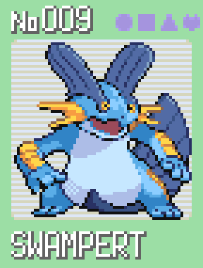
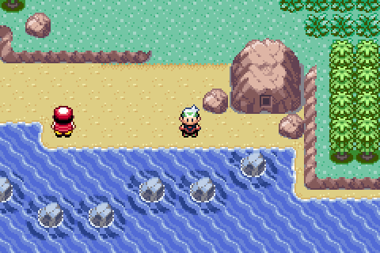
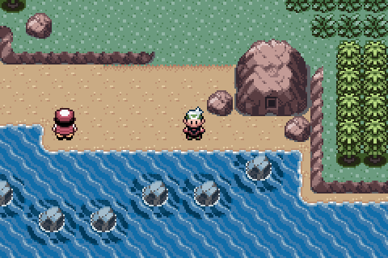
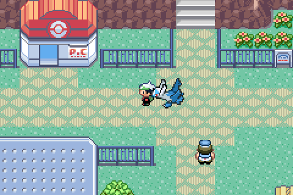
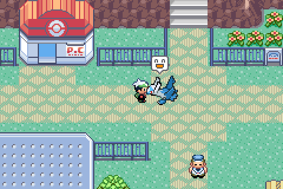

# Using the emulator

Installing the downloads, command-line options, controls, headless mode, the link cable and cheats.

## Installing a pre-built binary

Pre-built binaries for Linux (x86_64), macOS (Apple Silicon), and Windows (x86_64) are attached to every tagged release on the [Releases page](https://github.com/amyanger/gba-emulator/releases/latest).

Each download includes everything it needs, SDL2 included.

### macOS (Apple Silicon, macOS 11 or newer)

1. Download `gba_emulator-0.14.0-macOS-arm64.dmg` from the Releases page and open it.
2. Drag **GBA Emulator** into **Applications**.
3. Double-click **GBA Emulator**. The game library opens: click **Choose folder…** once to pick where you keep your games, then double-click one to play. You can also drop a ROM onto the app icon.

The app isn't signed with a paid Apple certificate, so the first launch is blocked with a "can't be opened" message. Open **System Settings > Privacy & Security**, scroll down and click **Open Anyway**. You only need to do this once. From Terminal, this does the same:

```bash
xattr -dr com.apple.quarantine "/Applications/GBA Emulator.app"
```

Saves are written next to the ROM. To use command-line options, run the binary inside the app:

```bash
"/Applications/GBA Emulator.app/Contents/MacOS/GBA Emulator" path/to/rom.gba --scale 4
```

### Linux (x86_64)

1. Download `gba_emulator-0.14.0-x86_64.AppImage` from the Releases page.
2. Make it executable: right-click it, open **Properties** and allow running it as a program, or run `chmod +x gba_emulator-0.14.0-x86_64.AppImage`.
3. Double-click it. The game library opens: click **Choose folder…** once to pick where you keep your games, then double-click one to play.

The folder and file dialogs use `zenity` (GNOME and most desktops) or `kdialog` (KDE). If neither is installed, drop a `.gba` file on the library window, or pass the ROM on the command line:

```bash
./gba_emulator-0.14.0-x86_64.AppImage path/to/rom.gba --scale 3
```

### Windows (x86_64)

1. Download `gba_emulator-0.14.0-Windows-AMD64.zip` from the Releases page and extract it.
2. Double-click `gba_emulator.exe` in the `bin` folder. The game library opens: click **Choose folder…** once to pick where you keep your games, then double-click one to play. Dragging a ROM onto the `.exe` also works.

Windows SmartScreen may warn that the app is from an unknown publisher, because it isn't signed with a paid certificate. Click **More info**, then **Run anyway**.

Command-line options still work from a terminal:

```
gba_emulator-0.14.0-Windows-AMD64\bin\gba_emulator.exe path\to\rom.gba --scale 3
```

### Other platforms

No pre-built binaries for Intel Macs yet. Build from source, see [Building from source](development.md#building-from-source).

## Game library

Starting the emulator without a ROM opens the game library. It lists every `.gba` file in your games folder, plus games you've played from anywhere else, with the title and game code from each ROM's header. The last game you played sits on top as **Continue playing**, so pressing **Enter** picks up where you left off.

| Input | Action |
|-------|--------|
| Up / Down, Page Up / Page Down, Home / End | Move the selection |
| A letter or number | Jump to the next game starting with it |
| Enter, double-click, or **Play** | Start the selected game |
| Cmd+O (macOS) / Ctrl+O | Open a single file |
| Drop a `.gba` on the window | Start that file |
| Esc | Quit |

The folder and the recently played list are kept in `library.txt` in the app's settings folder. Games Pokémon Companion supports get a **Companion** badge.

## Running from the command line

```bash
./build/gba_emulator <rom_file> [options]
```

## Options

| Flag | Description |
|------|-------------|
| `--bios <file>` | Path to GBA BIOS dump (optional, HLE fallback available). Overrides the BIOS chosen in [Settings](#settings) |
| `--scale <n>` | Window scale multiplier, 1 to 10 (default: 3) |
| `--cheats <file>` | Cheat file to use instead of `<rom>.cht` |
| `--patch <file>` | Apply this IPS, UPS or BPS patch to the ROM for the run (see [ROM patches](#rom-patches)) |
| `--cheat-report` | Print how each cheat was read (device, decoded codes, problems) and exit |
| `--keymap <file>` | Path to a keymap `.ini`, applied on top of the bindings saved from Settings (see [Keymap file](#keymap-file)) |
| `--link-master <path>` | Listen for a peer GBA at AF_UNIX socket path (host side) |
| `--link-client <path>` | Connect to a peer GBA at AF_UNIX socket path (client side) |
| `--mute` | Start with audio muted for this run (toggle back with `M`). The **Start muted** setting does the same every launch |
| `--video-filter <name>` | Screen filter for this run: `sharp`, `smooth` or `soft` (see [Screen filters](#screen-filters)) |
| `--color-correct` | LCD color correction for this run |
| `--trace <file>` | Write a per-instruction execution trace to `file` (expect 5-10x slowdown) |
| `--trace-from <hex>` | Only trace instructions at PC >= this address (hex) |
| `--trace-to <hex>` | Only trace instructions at PC <= this address (hex) |
| `--trace-frames <n>` | Stop tracing after `n` frames |

## Example

```bash
./build/gba_emulator roms/emerald.gba --bios bios/gba_bios.bin --scale 3
```

## Controls

These are the default bindings. Change them in Settings under **Controls** (see [Settings](#settings)).

| Key | GBA Button |
|-----|------------|
| Z | A |
| X | B |
| Enter | Start |
| Right Shift | Select |
| Arrow Keys | D-Pad |
| A | L Trigger |
| S | R Trigger |

| Key | Emulator Function |
|-----|-------------------|
| F1 | Show or hide [Following Pokemon](#following-pokemon) (original Pokemon Emerald US ROM plus your own HeartGold or SoulSilver ROM, set in Settings > General; remembered between launches) |
| F2 | Toggle Hardware X-Ray Mode |
| F3 | Toggle input display HUD (mini-GBA overlay showing held buttons) |
| F4 | Show or hide Overworld X-Ray: trainer sight lines and hidden items on the map (original Pokemon Emerald US/English ROM only, remembered between launches) |
| F9 | Show or hide Pokémon Companion (original US/English Pokemon Emerald, FireRed 1.0 or LeafGreen 1.1) |
| F10 | Cycle the Pokémon Companion page: Auto, Party, Route, Nuzlocke, Berries, Search, Hunt, Run (Berries and Hunt are Emerald only and hidden on FireRed and LeafGreen; Auto shows the battle page during battles; a battle switches to Auto and the old page returns afterwards, except on the Hunt page, which stays up) |
| [ and ] | Select the previous or next Pokemon on the Party page, pick which opponent the Battle page shows in a double battle, switch Nuzlocke views, open another place on the Berries page, move the Search selection, pick the target species on the Hunt page, or scroll the Run page (unless bound to a GBA button) |
| / | Start typing a Pokemon name, on the Search page (unless bound to a GBA button) |
| N | Start a Nuzlocke run, on the Nuzlocke page (unless bound to a GBA button) |
| J, twice | Move the clock to the next Mirage Island day, on the Route page (unless bound to a GBA button) |
| B | Turn berry alerts on or off, on the Berries page (unless bound to a GBA button) |
| D | Switch between the dashboard and the Details sheet, on the Run page (unless bound to a GBA button) |
| , and . | Pick the nature the Hunt page's Next match looks for, or which of your Pokemon the Battle page shows in a double battle (unless bound to a GBA button; Ctrl+, still opens Settings) |
| R, twice | Reset the Hunt page's encounter counts: the first press arms it for 3 seconds, the second resets (unless bound to a GBA button) |
| C, Shift+C | Save a trainer card of your team (original Pokemon Emerald, FireRed or LeafGreen US/English ROM): C makes the team grid, Shift+C the ace showcase (use the left Shift key, because right Shift is the GBA Select button by default and would press Select too). Saved next to the ROM as `<rom>.YYYYMMDD-HHMMSS.card.png`; works with the panel open or closed and while paused (ignored if bound to a GBA button, and reserved in Settings > Controls) |
| F5 | Save state to current slot |
| F6 | Edit label of current save-state slot |
| F7 | Open save-state slot picker |
| F8 | Load state from current slot |
| 0–9 | Select save state slot |
| Tab (hold) | Fast-forward |
| `` ` `` | Toggle fast-forward |
| `\` | Frame advance: pauses if running, then steps one frame per press (hold to keep stepping). Ignored during fast-forward or rewind |
| Backspace (hold) | Rewind (60s window, audio muted) |
| M | Toggle audio mute |
| H | Toggle HQ music: replays game music in high quality (games using the MP2K sound driver) |
| Space | Pause / resume emulation |
| Ctrl+, (Cmd+, on macOS) | Open Settings |
| F12 | Screenshot (saved next to ROM) |
| F11 | Toggle fullscreen |
| Escape | Quit (except on the Search page, where it clears and leaves the search box) |

On macOS, F-keys need **fn** held (for example fn+F9) unless the keyboard is set to use them as standard function keys.

In the F7 slot list, Up and Down pick a slot, Enter loads it, and Esc or F7 closes the list. F6 edits the label of the current slot once it has a save state: type the label, then Enter saves it and Esc cancels.

Most of these keys show a short notice at the top of the game when you press them. While the game is paused, fast-forwarding, rewinding or muted, or Overworld X-Ray is on, a small badge in the top left corner says so.

Save files (`<rom>.sav`) and save states (`<rom>.ss<N>`) are written next to the ROM.

## Settings

Press Ctrl+, (Cmd+, on macOS), or use the Settings entry in the macOS menu bar. Settings has five pages: Cheats, Controls, General, Video and Audio. Changes apply right away and are remembered between launches. The **Video** page is described under [Screen filters](#screen-filters) and the **Cheats** page under [Cheats](#cheats).

### Controls

Click the box next to a GBA button, in the keyboard column or the controller column, then press the key or controller button you want. Backspace clears the binding and Esc cancels. Controller triggers can be bound too.

- **Turbo A** and **Turbo B** press and release the button every 2 frames (15 times a second) while the key or button is held.
- Keys the emulator already uses can't be bound: F1 to F12, the number keys, Tab, `` ` ``, `\`, Space, M, H and C. Backspace and Esc can't be bound either, since they clear and cancel.
- The left stick always works as the D-pad.
- **Reset to defaults** restores the layout in the tables above. The default controller layout is A, B, Start, Back as Select, the D-pad, and the shoulder buttons as L and R. X and Y are unbound.

### General

| Setting | Description |
|---------|-------------|
| BIOS file | **Choose** a BIOS dump, or **Use built-in** for the HLE BIOS. Takes effect the next time you open a game. `--bios` overrides it |
| Fast-forward speed | 2x, 3x (default), 4x or Max. Applies to both Tab and `` ` `` |
| Pause when the window loses focus | Off by default |
| Following Pokemon | Turns [Following Pokemon](#following-pokemon) on or off, like F1. Available once a HeartGold or SoulSilver ROM is set |
| HeartGold/SoulSilver ROM | **Choose** your own HeartGold or SoulSilver ROM (`.nds`) for Following Pokemon |

### Audio

| Setting | Description |
|---------|-------------|
| Volume | Slider from 0 to 100% |
| Start muted | Launch with audio muted. `M` still toggles mute while playing, and `--mute` still works |
| HQ music | Turns [HQ music](hq-music.md) on or off, like H. Shows whether it is active, waiting for music, or not available for this game |

### Keymap file

Bindings are saved to `keymap.ini` in the app's settings folder, next to `prefs.ini`:

| OS | Folder |
|----|--------|
| macOS | `~/Library/Application Support/GBA Emulator/` |
| Windows | `%APPDATA%\GBA Emulator\` |
| Linux | `~/.local/share/GBA Emulator/` |

The file has one `NAME=value` line per button. Keyboard lines use the button name and an SDL key name. Controller lines add a `PAD_` prefix and use the SDL controller input name. The value `None` leaves a button unbound.

```ini
A=Z
B=X
UP=Up
TURBO_A=C
PAD_A=a
PAD_B=b
PAD_L=leftshoulder
PAD_R=righttrigger
PAD_TURBO_B=None
```

Button names are A, B, START, SELECT, UP, DOWN, LEFT, RIGHT, L, R, TURBO_A and TURBO_B. Controller names include a, b, x, y, back, start, leftshoulder, rightshoulder, lefttrigger and righttrigger. A file passed with `--keymap` is loaded after `keymap.ini`, so its lines win. Changing a control in Settings saves the full current layout, including anything loaded with `--keymap`, to `keymap.ini`.

## Screen filters

Open [Settings](#settings) (Cmd+, on macOS, Ctrl+, elsewhere) and pick **Video** to change how the game image is drawn. Changes show right away and are remembered between launches.

| Filter | Look |
|--------|------|
| Sharp | The original pixels, as the GBA drew them (default) |
| Smooth | Rounds jagged edges into clean curves, using the xBR scaler |
| Soft | A softer, painted look, using the Super xBR scaler |

| Sharp | Smooth | Soft |
|:-----:|:------:|:----:|
|  |  |  |

**Color correction** turns the bright, saturated colors games were drawn with into the darker, softer colors of a real GBA screen. It works with any filter.

| Color correction off | Color correction on |
|:--------------------:|:-------------------:|
|  |  |

Filters only change what you see. Screenshots (F12) still save the original pixels.

## ROM patches

Play a ROM hack, translation or fix patch without making a patched copy of the game. The patch is applied in memory each time the game starts, and neither file on disk is changed. IPS, UPS and BPS patches all work.

- **Patch next to the ROM:** give the patch the same name as the ROM, for example `emerald.gba` and `emerald.bps`, and open the ROM as usual. If there are several, `.bps` is used first, then `.ups`, then `.ips`.
- **Open the patch itself:** open or drop `Hack.bps` and the emulator plays it on `Hack.gba` from the same folder.
- **Any two files:** `--patch <file>` on the command line.

A patched game is a separate game with its own save. Its save, save states, cheats and logs are named after the patch (`emerald.bps.sav`), so your original `emerald.gba.sav` is never opened. If you already played the hack from a patched copy, rename that save to `<patch>.sav` to keep it.

UPS and BPS patches check that they are made for your ROM. If they aren't, a patch next to the ROM is skipped with a message and the original game starts. A patch you opened directly shows why it couldn't be applied. IPS patches have no such check, so use one made for your exact ROM. The Pokemon Companion stays off on patched games.

## Following Pokemon

Your lead Pokemon walks one tile behind you in Pokemon Emerald, the way it does in HeartGold and SoulSilver. Face it and press A to talk: it hops, shows a bubble, sometimes cries, and says a line in the HeartGold text box. What it says depends on the place, the weather, the time of day, its health and how it feels about you.

| Walking | Talking | Its reply |
|---|---|---|
|  |  |  |

To set it up, open [Settings](#settings) > General, click **Choose** next to HeartGold/SoulSilver ROM and pick your own `.nds` file (US HeartGold or SoulSilver). Then turn on **Following Pokemon** there or press F1. Both choices are remembered between launches.

- It needs the original Pokemon Emerald (US/English) ROM. Other games and ROM hacks run normally without it.
- It is cosmetic only. The game never sees the follower: nothing is written to Emerald's memory or your save, and it never changes friendship or gives items. Its mood is kept in a small `<save>.follow` file next to your save.
- The follower hides during battles and while you ride a bike, surf, dive or sail on Mr. Briney's boat, and walks out again once you are back on foot. Like in HeartGold, it goes back into its ball while a Pokemon Center nurse heals your team or when someone walks onto its tile, and comes out on your next step. It follows you through doors instead of waiting outside.
- It reacts to the world on its own, with a bubble over its head and no text box. A **!** when a trainer spots you, a **?** or **...** when you start talking to someone, a note or heart and a hop when you find an item, and a reaction when the weather changes on the same map (a Fire type sweats in the rain). These never pause the game.
- Stand still for a few seconds and it looks around, turns to you, hops or spins. A happy Pokemon sometimes adds a heart or a note, an unhappy one a frown or **...**. A poisoned one shows poison bubbles and one low on HP sweats. Stand still long enough and it nods off with a Zz.
- Sprites, text and the text box are read from your HeartGold or SoulSilver ROM each time the emulator starts. Nothing from that ROM is copied into the emulator or saved anywhere else.

## Headless mode

Run the emulator without an SDL window or audio output, writing one
FNV-1a hash of the 240×160 framebuffer per frame:

```bash
./gba_emulator <rom.gba> --headless --frames 240 --hash-out hashes.txt
```

| Flag | Meaning |
|------|---------|
| `--headless` | Skip SDL, audio, link cable, X-Ray (unless `--xray-out` is given), and rewind. |
| `--frames <n>` | Run exactly `n` frames then exit. Required with `--headless`. |
| `--hash-out <file>` | Write per-frame `<N> <FNV1a-hex>` lines. Defaults to stdout. |
| `--screenshot-out <file>` | After the run, save the final framebuffer as PNG. |
| `--input-script <file>` | Replay scripted keypad input. Headless only. Format below. |
| `--panel-out <file>` | After the run, render the Pokémon Companion panel to a PNG. Requires `--headless`. |
| `--card-out <file>` | After the run, render the trainer card (1200x630 PNG). `--panel-select N` picks the ace. Requires `--headless`. |
| `--card-style <s>` | Trainer card style, `grid` or `ace` (default `grid`). Requires `--headless`. |
| `--panel-density <f>` | Panel pixels per point, 0.5 to 4.0 (default 1.0). Requires `--headless`. |
| `--panel-page <p>` | Panel page: `auto`, `party`, `route`, `nuzlocke`, `berries`, `search`, `hunt` or `run` (default `auto`). `berries` and `hunt` exit with an error on FireRed and LeafGreen. Requires `--headless`. |
| `--panel-search <text>` | Open the Search page with this text typed in. Implies `--panel-page search`, and is an error with any other page. Requires `--headless`. |
| `--panel-select <n>` | Selected row on the party page, 0 to 5 for the party, then the Daycare rows (the two parents, then the breeding row) right after the last party Pokemon, which is 6 to 8 with a full party, the Nuzlocke view: 0 routes, 1 team, 2 graveyard, the open place on the Berries page, the Nth result on the Search page, 0 being the first, or 1 for the Details sheet on the Run page (default 0). Requires `--headless`. |
| `--library-folder <dir>` | Game folder for the library, used only when none has been chosen yet. |
| `--library-out <file>` | Render the library for `--library-folder` to a PNG and exit. Takes no ROM and never reads or writes `library.txt`. |
| `--nuzlocke-file <file>` | Track a Nuzlocke run in `file` during the run, starting one if the file has none. `--game-dump` then adds `nuz` lines. Requires `--headless`. |
| `--run-file <file>` | Keep the Run page's log in `file` during the run. Without it a headless run tracks nothing and writes no `.run` file. `--game-dump` then adds `run` lines, and `--panel-page run` shows it (without the file, that page says it needs `--run-file`). Requires `--headless`. |
| `--hunt-file <file>` | Keep the Hunt page's encounter counts in `file` during the run. Without it a headless run counts nothing and writes no `.hunt` file. `--game-dump` then adds `hunt` lines (with the whole Next match search run first), and `--panel-page hunt` shows it (without the file, that page says it needs `--hunt-file`). Requires `--headless`. |
| `--xray-out <file>` | After the run, render the Hardware X-Ray window to a 2400x1640 PNG. Requires `--headless` and an X-Ray build. |
| `--video-out <file>` | After the run, write the final frame through the screen filter as PNG, at the filter's own size for `--scale` (for example 720x480 for Smooth at scale 3). Requires `--headless`. |
| `--overworld-out <file>` | After the run, write the final frame at 3x (720x480 PNG) with the Overworld X-Ray drawn on it. Requires `--headless`; original Pokemon Emerald (US) only. |
| `--gift-audit <file>` | Walk every NPC in the ROM and list the Overworld X-Ray gift tags it would show, one line per NPC (`<group>.<map> lid=<id> <item>:<flag>`, hex). For checking the gift detection; original Pokemon Emerald (US) only. Requires `--headless`. |
| `--follower-hgss <rom>` | Turn on Following Pokemon for the run, using this HeartGold or SoulSilver ROM. `--screenshot-out` then includes the text box during a talk. Never writes the mood file. Requires `--headless`; original Pokemon Emerald (US) only. |
| `--game-dump <file>` | After the run, write the decoded game state (party, battle, encounters; on Emerald also an `[overworld]` section matching the final frame and a `[feebas]` section listing the Route 119 Feebas tiles) to `file`. Requires `--headless`. |

An input script has one event per line, `<frame> <press|release> <KEY>`,
where `<frame>` is the 0-based frame index (same as in `--hash-out`) and
`KEY` is one of `A B SELECT START RIGHT LEFT UP DOWN R L`. An event
applies before its frame runs. Frames must not decrease from one line to
the next. `#` starts a comment and blank lines are ignored. A malformed
line aborts the run with an error. Example:

```
# open the second menu entry
30 press DOWN
32 release DOWN
36 press A
38 release A
```

Headless mode is incompatible with `--link-master` / `--link-client`
(they would block the dispatch waiting for a peer).

## Link Cable

Two emulator instances on the same machine can connect over a UNIX domain socket and exchange GBA SIO multiplayer-mode packets. That is enough for Pokemon trade and battle between local windows.

Each window needs its own copy of the ROM, because the save, savestates and logs are named after the ROM file. Two windows on the same file would overwrite each other's save, so the second one refuses to start.

```bash
# Once: a second copy for the other player. It gets its own emerald-2.gba.sav.
cp roms/emerald.gba roms/emerald-2.gba

# Terminal 1 (host): opens the socket and waits for a peer.
./build/gba_emulator roms/emerald.gba --link-master /tmp/gba.sock

# Terminal 2 (client): connects to the host's socket.
./build/gba_emulator roms/emerald-2.gba --link-client /tmp/gba.sock
```

The host blocks at startup until the client connects. After both sides are up, in-game link interactions (Cable Club, trades, battles) cross between the two windows.

**Limitations:** Multiplayer 16-bit mode only, 2 players. Normal 8/32-bit and UART SIO modes are not implemented. There is no internet netplay, so the socket path must be local. The two emulators run lockstep at the SIO transfer point: one will briefly stall waiting for the other to reach the same `sio_tick` if they fall out of sync.

## Cheats

Cheats for a game live in `<rom>.cht` next to the ROM (for example `emerald.gba.cht`) and load automatically. Copy codes from a cheat site into it as they are written there, under a device line and a name:

```ini
# Lines starting with # are comments
[CodeBreaker]
Level 100 (first Pokemon, Emerald US)
32024540 0064

[ActionReplay]
Code name from the site
XXXXXXXX YYYYYYYY
XXXXXXXX YYYYYYYY
```

You can also add cheats while playing: open [Settings](#settings) > **Cheats**, paste the codes into the box and click **Add cheat**. The page shows how many codes it read and which device it detected. Click the device name to pick another one, which you have to do when it isn't sure. If the pasted text has a title line above the codes, it becomes the name unless you type your own. Below that, each cheat has a switch to turn it on or off, a device menu, and a × button that asks once more before deleting. Changes are saved to the game's `.cht` file.

- **Devices:** `[CodeBreaker]`, `[GameShark]` (v1/v2), `[ActionReplay]` (v3, also sold as GameShark v3/SP), plus `[GameSharkRaw]` and `[ActionReplayRaw]` for unencrypted codes. Encrypted codes are decrypted for you.
- **Detection:** when a block has no `device=` line, the emulator works out the device from the codes themselves (a master code's game ID line settles it). If it can't tell, the cheat is not run; add `device=override` under the name to force the section's device.
- **On/off:** `enabled=false` under the name turns a cheat off.
- **Master codes** ("must be on") are recognized and skipped; the emulator applies codes directly every frame, so no hook is needed. ROM patch codes, cheat-device button codes and `DEADFACE` seed changes are not supported and are reported as such.
- **Safety:** codes may only touch RAM, palette, VRAM, OAM and I/O. Before any cheat runs, the battery save is copied to `<rom>.sav.cheatbak1` (the last 5 copies are kept, `cheatbak1` is the newest). If that copy can't be made, cheats stay off.
- **Checking codes:** `--cheat-report` prints the detected device and the decoded operations for every cheat, which helps when a code doesn't seem to work.
